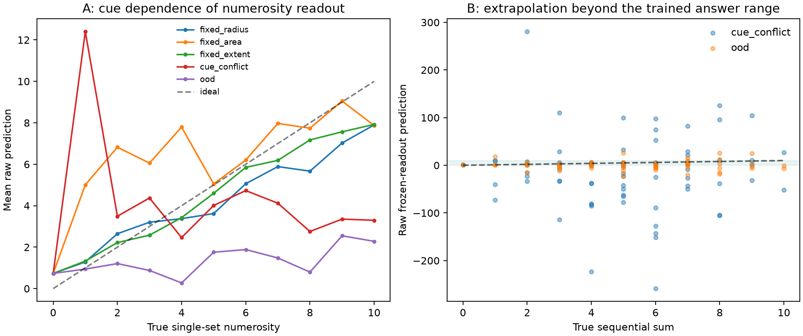

# 1차 예비실험 해석

수치가 큰 합산 오차를 숨기기 위해 예측을 clipping하거나 설정을 재선택하지 않았다.

B의 주 조건에서 원시 예측 범위는 -258.81~280.64이다.
예측의 61.1%가 학습한 정답 범위 0~10 밖에 있다.

이것은 선형 출력의 외삽 실패를 보여준다. 이를 신경망 활동의 수치적 발산과 동일시할 수는 없다.
모델의 tanh 상태는 유계이며, 저장한 활동량 및 포화율 진단을 함께 확인해야 한다.

A의 수량 오차도 단서가 바뀌면 증가했다. 따라서 현재 설정에서는 단서에 강한 수량 표현과
추가 학습 없는 합산 전이 중 어느 것도 충분히 확보했다고 볼 수 없다.

이 결과는 한 부분 회로, 한 입력 대응, 한 자극 시드와 정해진 동역학의 결과이다.
초파리 연결망 일반의 능력 또는 실제 초파리의 행동에 대한 부정적 결론으로 확대하지 않는다.

C의 조합 분할에서는 0, 3, 7, 10이라는 정답 자체를 학습하지 않는 문제와
정답 5의 새로운 피연산자 조합을 구분한다. 현재 C의 `answer_seen` 층은 정답 5에 한정되므로
폭넓은 조합 일반화 검증으로 해석하기에는 범위가 좁다.

후속 실험은 입력 대비/공간 대응과 수량 표현을 먼저 검증하고, 사전에 정한 A validation 탐색으로
설정을 선택한 뒤 새로운 test에서 재현해야 한다. 현재 test 성능을 올리기 위한 재조정은 하지 않았다.
