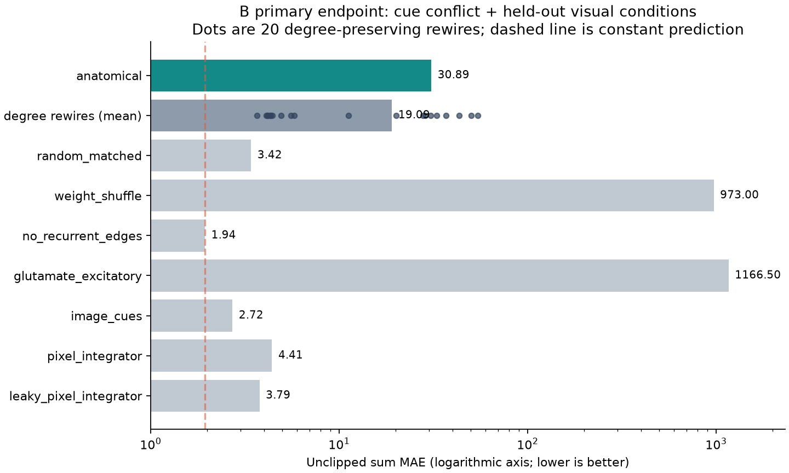
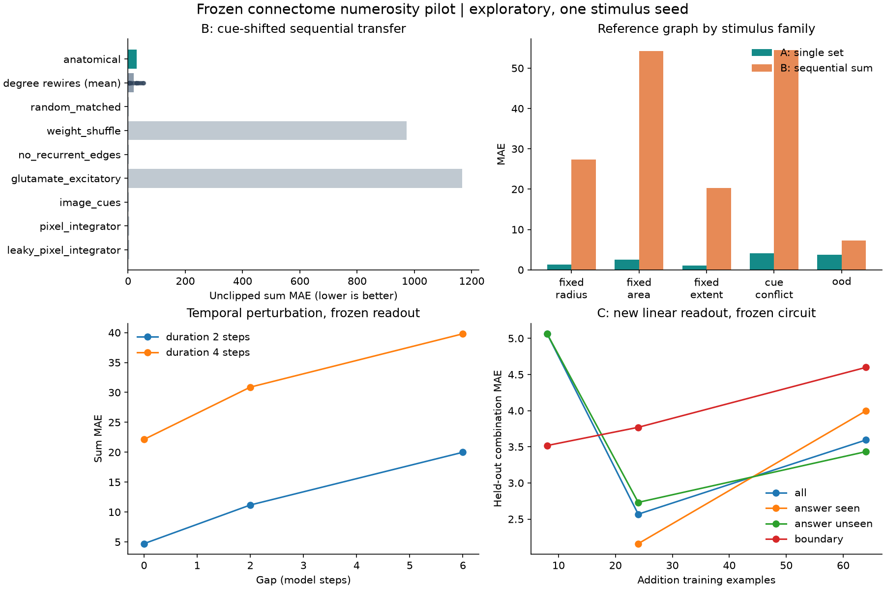
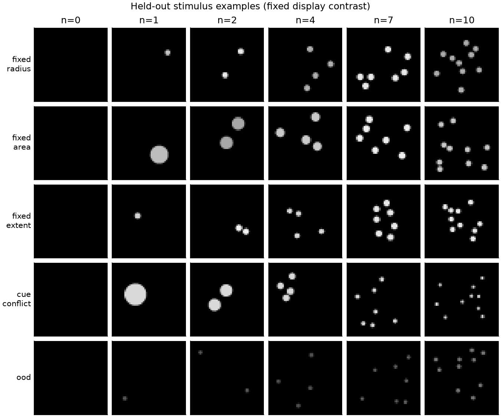

# 프로젝트 예비실험 결과

실험 범위: **실제 FlyWire 유래 부분 회로**. 탐색적 결과이며 확인 실험이 아니다.

- A, 단서 변화 조건 수량 MAE: **3.9622**
- B, 단서 변화 조건 합산 MAE: **30.8852**
- B, 정확한 합 비율: **5.56%**
- 재배선 20개 평균 B MAE: **19.0943**
- 학습 정답 평균만 내는 상수 예측기 B MAE: **1.9444** (합 정확도 16.67%)
- 실제/기준 − 재배선 평균 MAE: **11.7908** (음수가 기준에 유리)
- 위 평균 차이의 조건부 bootstrap 95% CI: [4.3340, 18.8792]

이 신뢰구간은 한 자극 시드와 한 입력 대응을 고정한 재배선 간 변동만 반영한다.
자극·입력 설정·개체 수준의 불확실성은 포함하지 않는다.

| 모델 | B MAE | 합 정확도 | 공통 alpha=1 MAE |
|---|---:|---:|---:|
| anatomical | 30.8852 | 5.56% | 740.2857 |
| random_matched | 3.4159 | 9.03% | 5.8222 |
| weight_shuffle | 973.0005 | 6.25% | 973.0005 |
| no_recurrent_edges | 1.9444 | 16.67% | 1.9444 |
| glutamate_excitatory | 1166.4963 | 6.25% | 1166.4963 |
| image_cues | 2.7214 | 10.42% | 2.7214 |
| pixel_integrator | 4.4100 | 11.11% | 5.0884 |
| leaky_pixel_integrator | 3.7859 | 8.33% | 4.3605 |

## 해석과 미완료 검증

현재 기준 연결망은 상수 예측기보다 B MAE가 크다. 이 설정에서 유용한 추가 학습 없는 합산 전이는 확인되지 않았다.

A의 수량 판독과 B의 합산 전이는 별개의 결과다. 비교군보다 낮은 오차만으로 수량 표현의 일반화나 덧셈 성공을 단정하지 않는다.
밝기·면적 단서가 바뀐 조건에서 A 자체가 충분히 작동하는지, 단순 적분기가 설명하는지 함께 판단해야 한다.
LC11 억제에 대한 생물학적 해석은 보류했다. 입력 대응의 독립 검증과 일반 시각 과제 대조가 필요하다.
glutamate 부호 민감도는 별도 조건으로 비교했다. 다중 자극/입력 시드, 공간/세포유형 제약 재배선, 반복 제시 적응 검증은 후속 단계다.
가공 원자료에 동일 뉴런쌍의 병렬 행이 있어 시냅스 수를 합친 후 기준을 적용했다. 추가로 공식 FlyWire 원본을 내려받아 체크섬 및 모든 모델 연결·시냅스 수·해부학적 선택의 일치를 검증했다.
최종 확인 실험과 외부 사전등록은 수행하지 않았다.

## 재현 자료

- `manifest.json`: 설정·코드 해시·환경·데이터 출처
- `metrics.csv`: 조건별 A/B 지표
- 각 모델의 `predictions.csv`: 모든 A/B trial의 원시 예측
- `single_readout.npz`: A에서 학습하고 B에서 고정한 판독기
- `stimuli.npz`, `stimuli_*.jsonl`: 실제 자극·정답·메타데이터
- `cue_audit.json`: 양수 개수에서 단서와 개수의 상관 및 범위
- `comparison.json`: 재배선 단위의 조건부 효과 비교

전체 실행시간: 933.6초. 모델 step은 생물학적 시간으로 환산하지 않았다.

자료: [가공 데이터](https://zenodo.org/records/21549559), [FlyWire 원자료](https://zenodo.org/records/10676866).
코드와 실험은 사용자 제공 기획안을 바탕으로 이 작업 폴더에서 작성·실행했다.

## 실행 후 독립 검증

- 공식 FlyWire v783 원본 852,022,274바이트의 기탁 MD5를 확인했다.
- 원본에서 추출한 모든 모델 edge, 시냅스 수, 해부학적 이웃 선택이 정확히 일치했다.
- 저장한 28개 모델의 모든 A/B 정답과 주 MAE를 CSV에서 독립 재계산했다.
- A/B/C 사이에 0이 아닌 동일 이미지가 공유되지 않았고, B 전후 판독기 해시가 모두 일치했다.
- 자세한 증거: `canonical_reconciliation.json`, `verification.json`.
- 해석: [INTERPRETATION.md](INTERPRETATION.md), [추가 진단 그림](failure_diagnostics.png).
