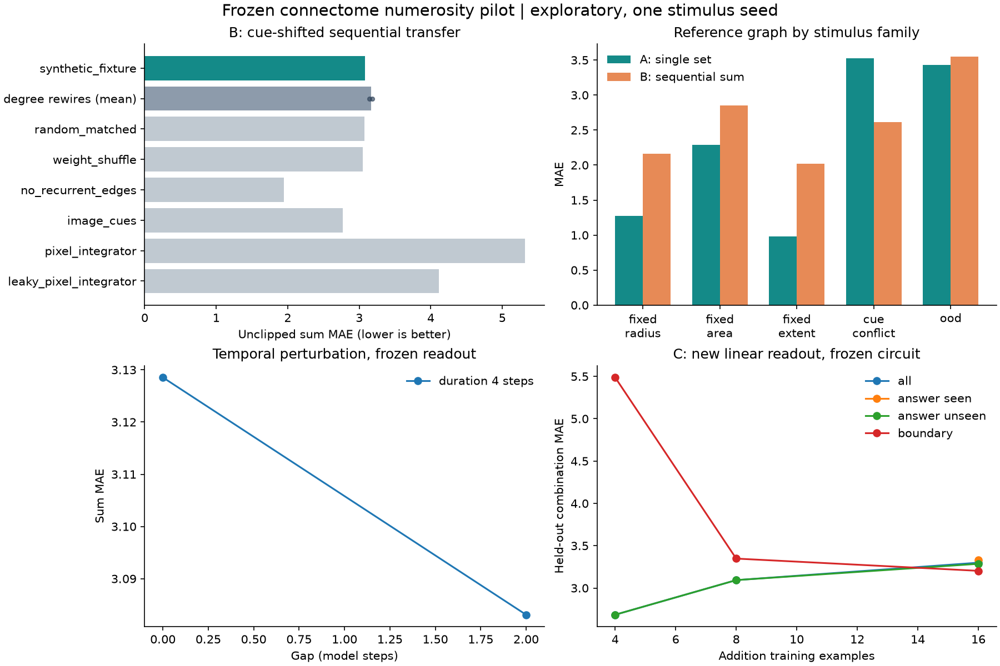
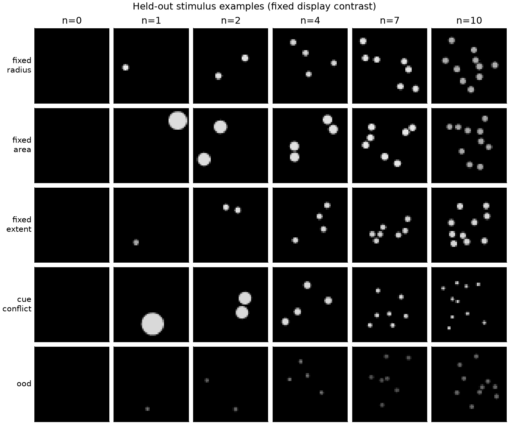

# 프로젝트 예비실험 결과

실험 범위: **합성 연결망을 사용한 소프트웨어 검증**. 탐색적 결과이며 확인 실험이 아니다.

- A, 단서 변화 조건 수량 MAE: **3.4798**
- B, 단서 변화 조건 합산 MAE: **3.0831**
- B, 정확한 합 비율: **11.11%**
- 재배선 2개 평균 B MAE: **3.1636**
- 실제/기준 − 재배선 평균 MAE: **-0.0805** (음수가 기준에 유리)
- 위 평균 차이의 조건부 bootstrap 95% CI: [-0.1007, -0.0603]

이 신뢰구간은 한 자극 시드와 한 입력 대응을 고정한 재배선 간 변동만 반영한다.
자극·입력 설정·개체 수준의 불확실성은 포함하지 않는다.

| 모델 | B MAE | 합 정확도 | 공통 alpha=1 MAE |
|---|---:|---:|---:|
| synthetic_fixture | 3.0831 | 11.11% | 4.3276 |
| random_matched | 3.0696 | 9.72% | 4.0727 |
| weight_shuffle | 3.0491 | 9.72% | 4.3548 |
| no_recurrent_edges | 1.9444 | 16.67% | 1.9444 |
| image_cues | 2.7722 | 9.72% | 2.7722 |
| pixel_integrator | 5.3208 | 8.33% | 6.0953 |
| leaky_pixel_integrator | 4.1106 | 6.94% | 4.6421 |

## 해석과 미완료 검증

A의 수량 판독과 B의 합산 전이는 별개의 결과다. 비교군보다 낮은 오차만으로 수량 표현의 일반화나 덧셈 성공을 단정하지 않는다.
밝기·면적 단서가 바뀐 조건에서 A 자체가 충분히 작동하는지, 단순 적분기가 설명하는지 함께 판단해야 한다.
LC11 억제에 대한 생물학적 해석은 보류했다. 입력 대응의 독립 검증과 일반 시각 과제 대조가 필요하다.
다중 자극/입력 시드, 흥분·억제 부호 민감도, 공간/세포유형 제약 재배선, 반복 제시 적응 검증은 후속 단계다.
최종 확인 실험과 외부 사전등록은 수행하지 않았다.

## 재현 자료

- `manifest.json`: 설정·코드 해시·환경·데이터 출처
- `metrics.csv`: 조건별 A/B 지표
- 각 모델의 `predictions.csv`: 모든 A/B trial의 원시 예측
- `single_readout.npz`: A에서 학습하고 B에서 고정한 판독기
- `stimuli.npz`, `stimuli_*.jsonl`: 실제 자극·정답·메타데이터
- `cue_audit.json`: 양수 개수에서 단서와 개수의 상관 및 범위
- `comparison.json`: 재배선 단위의 조건부 효과 비교

전체 실행시간: 1.8초. 모델 step은 생물학적 시간으로 환산하지 않았다.

자료: [가공 데이터](https://zenodo.org/records/21549559), [FlyWire 원자료](https://zenodo.org/records/10676866).
코드와 실험은 사용자 제공 기획안을 바탕으로 이 작업 폴더에서 작성·실행했다.
